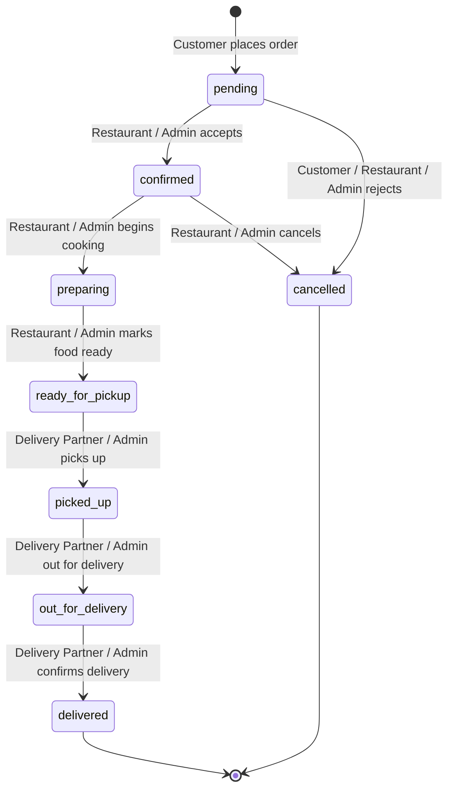

# FoodRush System Architecture

FoodRush is a hyper-local food delivery platform built on an npm-workspaces monorepo.

```
                    ┌──────────────────────────────────────────┐
                    │               FoodRush Web               │
                    │   React 19 + Vite + Tailwind CSS v4      │
                    │      React Query + Zustand Store         │
                    └─────────────────────┬────────────────────┘
                                          │
                        HTTP REST / JSON  │  Socket.IO (WS)
                                          │
                    ┌─────────────────────▼────────────────────┐
                    │               FoodRush API               │
                    │    Node.js + Express + TypeScript        │
                    │     Zod + JWT + Helmet + Rate Limit      │
                    └──────┬──────────────┬──────────────┬─────┘
                           │              │              │
                    ┌──────▼─────┐ ┌──────▼─────┐ ┌──────▼──────────┐
                    │  MongoDB   │ │  Payment   │ │    Cloudinary   │
                    │  ReplSet   │ │  Gateway   │ │  & File Storage │
                    │ (Mongoose) │ │  (Mock/RP) │ │                 │
                    └────────────┘ └────────────┘ └─────────────────┘
```

---

## 1. Monorepo Structure

- **`apps/api`**: Express 4 REST & WebSocket server with TypeScript. Strict request validation with Zod, Mongoose schemas, token rotation, and atomic state transitions.
- **`apps/web`**: Single-page application using React 19, React Router v7, `@tailwindcss/vite`, TanStack React Query, Lucide icons, and Zustand for auth.
- **`docs/`**: Comprehensive architectural, API, and deployment documentation.

---

## 2. Role-Based Access Control (RBAC)

Four distinct user roles operate across the platform:

| Role | Access Scope |
|---|---|
| `customer` | Browse catalog, manage cart, apply coupons, checkout, track orders, reviews, favourites, addresses, notifications |
| `restaurant` | Restaurant Dashboard, menu management (CRUD, Cloudinary photos, availability toggles), order acceptance, kitchen prep workflow, sales analytics |
| `delivery` | Delivery Fleet Portal, duty online/offline toggle, pool of ready-for-pickup orders, pickup/delivery status updates, payout tracking |
| `admin` | Platform Overview, restaurant approvals/suspensions, delivery partner verification, coupon management, platform settings, refund processing, stale order cleanup |

---

## 3. Order State Machine

Status transitions follow strict role and predecessor checks (`apps/api/src/services/orderState.ts`):



---

## 4. Open Edge Cases Handled

### Edge Case 1: Stale Unpaid Orders
- **Problem**: Online orders that customers abandon before payment settlement previously remained indefinitely in `pending` and `unpaid`, potentially hoarding coupons or inventory.
- **Solution**:
  1. `cleanupStaleOrders(staleMinutes = 15)` periodically scans for orders where `paymentMethod === 'online'`, `paymentStatus === 'unpaid'`, `status === 'pending'`, and `createdAt` is older than 15 minutes.
  2. The orders are automatically transitioned to `cancelled` with an audit history log `{ status: 'cancelled', by: 'system' }`.
  3. Any reserved coupon usage is restored (`usedCount - 1`, user removed from `usedBy`).
  4. Real-time `order:updated` event is broadcasted.
  5. Runs every 60 seconds automatically on the server and is also available on-demand in the Admin Panel.

### Edge Case 2: Refund Handling for Cancelled Paid Orders
- **Problem**: Previously, when a customer or restaurant cancelled an order whose payment was already settled, `paymentStatus` was flagged as `refund_pending` but had no resolution mechanism.
- **Solution**:
  1. Admin Panel identifies all orders in `paymentStatus: 'refund_pending'`.
  2. The admin can trigger `processOrderRefund(orderId, adminId, reason)`.
  3. A gateway refund ID (`ref_<hex>`) is generated, `paymentStatus` transitions to `refunded`, and full refund audit details are stamped onto the order document.
  4. An in-app push notification is delivered to the customer detailing the refund amount and reference ID.

---

## 5. Image Upload Architecture
- In production, images upload directly to Cloudinary using signed REST uploads.
- When Cloudinary credentials are not configured (local dev/testing), the upload service safely falls back to local static disk storage in `apps/api/uploads/`, exposed under `/uploads/`, with data URI resilience.
- Food cards and restaurant cards seamlessly render the photo or fall back to the branded emoji tile.
